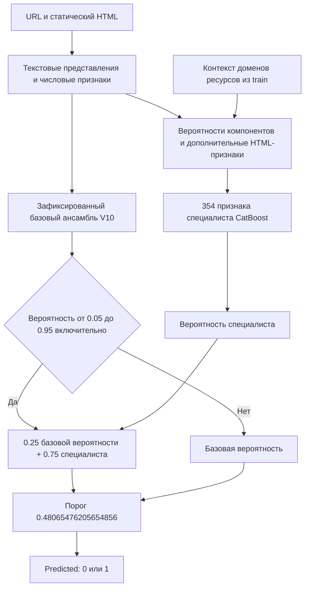

# Техническое описание V17

V17 классифицирует URL и предоставленный организатором статический HTML. Итоговый файл - `submission_content_v17.csv`: 16000 ответов, из них 6016 с классом `1`. Обученный ансамбль восстанавливается из файлов репозитория в `.runtime/artifacts/v17/ensemble.joblib`.

Public F1=0.995082 сообщен участником и привязан к SHA256 этого файла в [evidence/tournament_feedback.json](../evidence/tournament_feedback.json). Независимого обращения к таблице турнира и приватной оценки нет. Более ранний [evidence/metrics.json](../evidence/metrics.json) содержит `candidate_public_f1: null`, поскольку создан до получения этой обратной связи.

## 1. Данные и постановка

Входы организатора:

- `train.csv`: `url,result`, где `result` равен 0 или 1.
- `test.csv`: `url`; порядок строк сохраняется.
- `sample.csv`: столбцы `Id,Predicted`.
- Архив страниц с HTML для train и test.

Исходный URL-train содержит поврежденный HTML/502-фрагмент. Загрузчик исключает записи с неправильным числом полей, неверной меткой или URL, объединяет одинаковые URL с согласованными метками и удаляет конфликтующие URL. Из первоначального CSV остаются 63722 уникальных примера. Из предоставленного train с контентом восстановлены еще 178 собственных примеров; итоговый пул содержит 63900 строк.

Первые эксперименты использовали 50977 development-строк и 12745 диагностических строк. Последние 178 восстановленных строк учитываются отдельно. Все метки обучения V17 взяты у организатора. Опубликованный SQL, внешний справочник и `submission_reference.csv` не входят в его обучение или прогноз.

## 2. Подготовка HTML и URL

Страницы разбираются локально. Переходы по ссылкам, DNS-запросы, загрузка ресурсов и выполнение JavaScript для прогноза не нужны.

В `phishing_url/content.py` HTML ограничивается 1000000 символов для разбора. Извлекаются заголовок до 600 символов, видимый текст до 12000 символов и представление разметки до 16000 символов. Длинные текстовые представления сохраняют начало и конец в установленном лимите. Парсер lxml использует `no_network=True`.

Основные группы признаков:

| Группа | Примеры |
| --- | --- |
| Структура URL | Длина, IP вместо имени, HTTPS, число поддоменов, глубина пути, параметры, цифры, энтропия, punycode |
| Структура HTML | Формы и поля password, внешние ссылки, script/iframe, перенаправления, пустая страница |
| Текст | TF-IDF по словам и символьным фрагментам заголовка, видимого текста, разметки и URL |
| Дополнительный HTML | Адреса ресурсов, метаданные, canonical, Open Graph, CSS-представление |
| Контекст train | Непротиворечивые совпадения URL, хешей, доменов, заголовков и иерархии URL |
| Выходы классификаторов | Вероятности компонентов, их логиты, минимум, максимум, разброс и число голосов |

Контекстные таблицы строятся по разрешенным train-строкам. Для нового test они не используют его истинные классы. Точные совпадения с train являются отдельным правилом, поэтому такую строку нельзя считать проверкой распознавания ранее неизвестного адреса.

## 3. Архитектура



Базовый ансамбль сохранен в составе модели. В нем используется калиброванная линейная SVM над зафиксированным TF-IDF-представлением. Представление наследует словари и IDF текстовой модели C16. Ее логистическая регрессия и SVM используют согласованные векторизаторы; `v12_bundle.py` проверяет совпадение словарей и IDF и рассчитывает разреженную матрицу один раз.

В составе базовых расчетов также используются CatBoost по числовым/категориальным признакам, текстовая модель с хешированием, дополнительная текстовая модель HTML и смесь текстового и CatBoost-классификаторов URL. При коротком или ошибочном HTML правило `short100_or_error` увеличивает роль URL-компонента. Применяются сохраненные правила и сглаженный контекст собственных train-строк.

Для специалиста рассчитываются семь вероятностей: `svm`, `c16`, `numeric`, `url`, `cat`, `hashed`, `extra`, а также их производные, числовые URL/HTML-признаки и контекст. Их объединение и порядок проверяются по сохраненной схеме из 354 столбцов. Функции из модуля V11 используются для сборки признаков; отдельная новая обученная метамодель V11 в итоговый прогноз V17 не добавляется.

Три ключа ресурсного контекста: домен canonical, домен Open Graph и основной домен ресурса. Для каждого формируются три признака: логарифм поддержки, логарифмическое свидетельство класса и признак чистоты. Получаются девять ресурсных признаков.

Сглаженная вероятность домена:

```text
p_resource = (n_phishing + 10 * prior) / (n_total + 10)
```

`prior` - доля фишинга в обучающей части контекста. Для fit-строк при подготовке соответствующих счетчиков вычитается вклад собственной строки. Это контролирует прямое использование ее метки в счетчике; ограничения всей схемы валидации приведены ниже.

Пусть `p0` - базовая вероятность, `q` - вероятность специалиста. Тогда:

```text
если 0.05 <= p0 <= 0.95:
    p17 = 0.25 * p0 + 0.75 * q
иначе:
    p17 = p0

Predicted = int(p17 >= 0.48065476205654856)
```

В test специалист применяется к 1480 строкам. Ответы V17 отличаются от V15 в 12 строках, от V10 в 26 строках.

## 4. Обучение V17

V17 сохраняет базовые модели и переобучает выбранный дополнительный CatBoost на всех доступных собственных неуверенных train-примерах. У V15 этот компонент использовал 5885 development-примеров; у V17 - 7119.

| Источник строк специалиста | Число |
| --- | ---: |
| Development | 5885 |
| Прежняя диагностика | 1215 |
| Восстановленные собственные train-строки | 19 |
| Всего | 7119 |

Development использует сохраненные OOF-признаки, то есть признаки из прошлой процедуры предсказания вне соответствующего обучения. Для дополнительных строк признаки получены development-моделью и development-счетчиками. На 1393 строках пересчитаны новые признаки: 1215 диагностических и все 178 восстановленных; из последних в обучение отобраны 19 неуверенных.

До этого шага зафиксированы параметры, вес смеси, порог, схема признаков и контрольные суммы входов. Порог не подбирается заново по test. Протокол: [evidence/preregistered.json](../evidence/preregistered.json).

### Параметры финального специалиста

| Параметр | Значение |
| --- | --- |
| Алгоритм | `CatBoostClassifier` |
| `iterations` | 800 |
| `depth` | 5 |
| `learning_rate` | 0.04 |
| `l2_leaf_reg` | 30.0 |
| `loss_function` | `Logloss` |
| `random_seed` | 20261010 |
| `thread_count` | 2 |
| `allow_writing_files` | false |
| Вес специалиста | 0.75 |
| Порог класса 1 | 0.48065476205654856 |

Базовая SVM использует `C=0.5`, `LinearSVC`, три внутренних разбиения для sigmoid-калибровки и `ensemble=False`. C16 использует `C=16.0`, `min_df=2` и обучение словаря/IDF на всех строках разрешенной стороны обучения. Точные реализации находятся в `phishing_url/v9_margin.py`, `v7_text.py`, `html_text.py`; параметры специалиста - в `v12_expert.py`.

## 5. Оценка качества

F1 рассчитывается для фишингового класса:

```text
F1 = 2 * TP / (2 * TP + FP + FN)
```

| Оценка | F1 | FP | FN | Как интерпретировать |
| --- | ---: | ---: | ---: | --- |
| Исторический V15, development OOF | 0.9891898966 | 180 | 233 | Выбор семейства перед финальным V17 |
| Исторический V15, диагностика | 0.9914136126 | 34 | 48 | Повторно использованная диагностическая часть |
| Независимый validation V17 после финального обучения | Не измерен | - | - | Прежняя диагностика уже вошла в обучение |
| Public V17, сообщено участником | 0.995082 | Неизвестно | Неизвестно | Сохраненная обратная связь, без независимого чтения таблицы |
| Private V17 | Неизвестен | Неизвестно | Неизвестно | Результат не получен |

Development и диагностика использовались при предыдущем поиске. Базовые OOF-представления не строились полностью заново внутри каждого разбиения специалиста. Это не полностью вложенная кросс-валидация и не независимая оценка будущего качества. Метрики V15 не приписываются переобученному V17.


## Воспроизведение этой поставки

Команды запуска и точный объем повторного обучения приведены в [README](../README.md) и [протоколе воспроизводимости](REPRODUCIBILITY.md). Все нужные входы и веса входят в этот репозиторий в `payload/`; большие файлы восстанавливаются автоматически с проверкой размера и SHA256.
